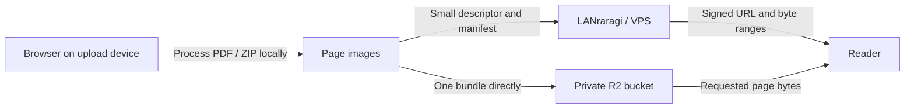

# LANraragi R2

[中文](README.md) · [English](README.en.md)

## Companion mobile apps: LanR2der

<a href="https://github.com/Fuzage/LanR2der"></a>

Connect an iPhone or Android device to this server for a **local bookshelf, R2 reading, whole-book offline downloads, in-app uploads, metadata/category editing and privacy controls**. Enter your own server address and API Key on first launch.

**[Visit the LanR2der project page to choose an iOS or Android version](https://github.com/Fuzage/LanR2der)**

iOS requires **26.0+**; the IPA is unsigned and must be signed before installation. Android requires **9.0 (API 28)+**. Both apps ask you to enter your own server address and API Key on first launch. The platforms use independent version numbers; open the app project page and choose the release for your device.

Current clients support **bookshelf layout presets**: create, switch, overwrite, or refresh a preset from the small button at the upper-left of the bookshelf. The tree and ordering are stored in this LANraragi instance's Redis database and shared by iOS and Android devices connected to the same instance. Update to an image containing `/api/lanr2der/shelf-presets` to use this feature. Switching or refreshing replaces the local arrangement; first connection never overwrites a local shelf automatically. Keep the existing `database` volume when updating.

---

A community modification of [LANraragi 0.9.81](https://github.com/Difegue/LANraragi/tree/v.0.9.81) that adds **direct Cloudflare R2 uploads and page-range reading** to the native upload page and web reader. Each deployment uses its owner's R2 account, private bucket and S3 credentials.

Each page read still requests its byte range. Bundling reduces upload requests, not the number of page-read operations. Storage, operations and included usage remain subject to Cloudflare's pricing and your account billing.

This is not an official LANraragi release. The base version stays at **0.9.81**; the image's `latest` tag means the latest build of this modification, not automatic upgrades to upstream LANraragi.

## What has changed

| Area | Behavior in this version |
| --- | --- |
| Native upload page | R2 and VPS upload buttons, multiple-file queue, per-book progress, category selection/creation, and links to the existing metadata editor |
| Local file processing | Preserves existing JPG/PNG/WebP bytes in image archives; extracts reusable embedded PDF images first; decoded embedded images can be saved losslessly as PNG; remaining PDF pages are rendered at the selected DPI and encoded as lossless WebP |
| R2 upload | Concatenates each book's processed pages into one bundle and uploads it directly to R2; does not also upload the original PDF/ZIP or a second full ZIP |
| Web reader | Fetches individual pages directly from the R2 bundle using registered byte offsets and HTTP Range; includes progress-state fixes |
| VPS storage | Keeps small CBZ descriptor archives, cover/page thumbnails, Redis metadata, categories and reading progress |
| Archive deletion | Deletes the registered R2 bundle and manifest together with the archive; deleting a category does not delete its books |
| R2 administration | Adds `/config/r2` for enable/disable, endpoint, bucket, credentials, signed-URL lifetimes, saved-connection checking and a CORS template |
| Configuration | Supports web settings and environment overrides; nonempty environment values win and are read-only in the web page; blank credential fields preserve the saved values |
| Integration fixes | Unicode manifests, descriptor handling, archive size/page-count reporting, reader progress and private-API cache behavior |
| Distribution | Docker build for the browser importer, plus GitHub Actions publishing amd64 and arm64 images to GHCR |

Preserving a JPEG avoids another encoding pass; it does not reverse compression already present in that JPEG. A lossless encoding of a rendered PDF page still represents the pixels at the chosen DPI, rather than retaining every possible vector detail.

## Storage and traffic



| Location | Stored data |
| --- | --- |
| R2 | `reading/<batch>/book.bin` and `manifest.json` |
| VPS `content` | Small CBZ descriptors; original archives when choosing VPS upload |
| VPS `thumb` | Covers and small page thumbnails |
| VPS `database` | Metadata, categories, progress and saved web R2 configuration |
| Upload device | Temporary processing data; the independent importer's result ZIP is a local download |

## Install

Install Docker and Docker Compose. The public GHCR image becomes anonymously pullable after the build succeeds and its package visibility is Public.

### Published image

```sh
git clone https://github.com/Fuzage/LANraragi-R2.git
cd LANraragi-R2
cp .env.example .env
```

Set this in `.env`:

```dotenv
LANRARAGI_IMAGE=ghcr.io/fuzage/lanraragi-r2:latest
```

Then run:

```sh
docker compose pull
docker compose up -d --no-build
```

### Build locally

```sh
git clone https://github.com/Fuzage/LANraragi-R2.git
cd LANraragi-R2
cp .env.example .env
docker compose up -d --build
```

Open `http://your-server:3000`. A fresh installation uses the upstream default administrator password `kamimamita`; change it after signing in. Use your own HTTPS domain for Internet access. Set `LANRARAGI_PORT` in `.env` to change the published port.

Compose creates persistent volumes for content/descriptors, thumbnails, the database and sideloaded plugins. Keep these volumes during upgrades; **do not upgrade with `docker compose down -v`**.

## Configure Cloudflare R2

### Enable R2 and create a bucket

Sign in to the [Cloudflare dashboard](https://dash.cloudflare.com/), open **Storage & databases → R2 → Overview**, complete the subscription setup if needed, and create a bucket such as `my-comics`. Bucket names use 3–63 lowercase letters, digits or hyphens, with no leading/trailing hyphen. See [bucket creation](https://developers.cloudflare.com/r2/buckets/create-buckets/).

For initial setup, use the default location and Standard storage. Keep the bucket private: this implementation uses signed requests, so a public r2.dev URL or public bucket domain is unnecessary. Subscription and billing terms are described in [getting started](https://developers.cloudflare.com/r2/get-started/) and [pricing](https://developers.cloudflare.com/r2/pricing/).

### Create S3 credentials and copy the endpoint

In the R2 overview, use **Account Details → API Tokens → Manage** to create an R2 token with **Object Read & Write** for your bucket. Record its **Access Key ID** and **Secret Access Key**; the secret is only shown once. Use these S3 credentials, rather than a general Cloudflare API key. See [R2 authentication](https://developers.cloudflare.com/r2/api/tokens/).

Copy the provided S3 endpoint. Typical values are:

```text
Default: https://<ACCOUNT_ID>.r2.cloudflarestorage.com
EU:      https://<ACCOUNT_ID>.eu.r2.cloudflarestorage.com
US:      https://<ACCOUNT_ID>.us.r2.cloudflarestorage.com
```

Jurisdiction-specific buckets require their corresponding endpoint. Enter the bucket separately: do not append `/bucket-name`, use a public r2.dev address, or substitute your LANraragi website URL. See the [official endpoint notes](https://developers.cloudflare.com/r2/api/tokens/).

### Set CORS

Open your bucket's **Settings → CORS Policy → Add CORS policy**, choose JSON and save this template with your actual website origin. The project's R2 settings page also generates it. See [Cloudflare's CORS guide](https://developers.cloudflare.com/r2/buckets/cors/).

```json
[
  {
    "AllowedOrigins": ["https://comics.example.com"],
    "AllowedMethods": ["PUT", "GET", "HEAD"],
    "AllowedHeaders": ["content-type", "range"],
    "ExposeHeaders": ["ETag", "Content-Range", "Content-Length"],
    "MaxAgeSeconds": 3600
  }
]
```

An origin has a scheme, host and optional port, without a path or trailing slash. List each required website origin separately. Range access and response headers are required by this reader's bundle handling. Signed URLs authorize requests; CORS additionally permits browser access and does not make the bucket public. See [presigned URLs](https://developers.cloudflare.com/r2/api/s3/presigned-urls/).

## Enable R2 in LANraragi

### Web settings

1. Open **Admin Settings → R2 storage settings**, or `/config/r2`.
2. Enter the endpoint, bucket, Access Key ID and Secret Access Key.
3. Enable R2 and save.
4. Check the saved connection. This checks bucket read access without writing a test object; it does not prove write access or browser CORS.
5. Configure bucket CORS, then upload and read one small book to verify the complete path.

Saved credentials are never filled back into the page. Leave the fields blank to retain them, or enter new values to replace them. Web settings persist in the database volume; workers observe updates within approximately two seconds.

The normal archive metadata JSON export excludes R2 credentials. A full database-volume backup contains them and must be treated as private. Disabling R2 does not delete objects, but prevents new valid reading signatures. Migrate objects while preserving their paths before changing accounts or buckets.

### Environment configuration

Empty R2 environment values fall back to web settings. Nonempty values override them and make the corresponding web fields read-only. `LRR_R2_ENABLED=0` explicitly disables R2.

```dotenv
LRR_R2_ENABLED=1
LRR_R2_ENDPOINT=https://YOUR_ACCOUNT_ID.r2.cloudflarestorage.com
LRR_R2_BUCKET=my-comics
LRR_R2_ACCESS_KEY_ID=YOUR_ACCESS_KEY_ID
LRR_R2_SECRET_ACCESS_KEY=YOUR_SECRET_ACCESS_KEY
LRR_R2_PUT_TTL=21600
LRR_R2_GET_TTL=43200
```

After environment changes, run `docker compose up -d --force-recreate`. Do not commit `.env`; it is excluded from the build context. Lifetimes are seconds, between 60 and 604800. The defaults above are six hours for upload and twelve hours for reading.

## Upload, read and delete

- Choose **Upload to R2** on `/upload`, select one or more files, and optionally assign a category. Each file becomes a separate archive.
- Processing runs on the upload device. Keep the page open; mobile backgrounding may suspend or interrupt work.
- After processing, the browser sends one bundle to R2. LANraragi then verifies the object and registers the archive. Wait for completion after the verification/registration message.
- `/r2-import/index.html` remains available as an independent importer; the native upload page provides the batch queue.
- Reading-page traffic comes from R2. Covers, small thumbnails and metadata requests use LANraragi.
- Deleting a registered comic cleans up its associated R2 objects. Categories only organize comics.
- An interrupted upload before registration can leave orphaned objects. There is currently no automatic orphan collector. A missing library entry alone is not a reason to empty a bucket.

## Upgrades, backups and clients

Back up the database, descriptors/original archives and thumbnails before replacing an existing 0.9.81 image. Preserve the original volume mappings. Existing VPS comics are not automatically migrated to R2; import them separately if desired.

Metadata JSON includes archive information and R2 page mappings, but is not an R2 object backup. Full recovery requires the database/descriptors and the objects in the bucket. Keep original PDF/ZIP backups separately if you need them; R2 imports store reading pages by default.

Third-party clients need to understand `ranges` in the page manifest, send HTTP Range and handle `206 Content-Range`. Older clients treating every `/files` URL as a standalone image may download the entire bundle and fail to decode it. The web reader in this repository is adapted.

Current implementation limits are 500 pages and 5 GiB per book. It uses one PUT without resumable/multipart continuation. R2 imports support JPG/PNG/WebP images and PDF/ZIP/CBZ, not RAR/7z. Test actual speed on your network; this project does not guarantee performance in a particular location.

## Troubleshooting

| Symptom | Check |
| --- | --- |
| Read-only setting fields | Remove the matching nonempty container environment values, recreate the container, then use web settings |
| R2 disabled | Enable flag and all required fields; environment `0` overrides the web flag |
| Connection check fails | S3 endpoint, bucket, credentials, token scope/permissions and VPS connectivity |
| Read check succeeds but browser upload fails | Actual CORS origin, PUT/content-type allowances and write permission |
| Covers load but pages fail | R2 enabled state, missing objects, Range/CORS configuration and client bundle support |
| Signature mismatch | Use the complete freshly signed URL unchanged; check credentials and server clock |
| Stale results after changes | Remove proxy/Cloudflare caching from `/api/*` and other dynamic admin/upload routes |
| Empty library after upgrade | Confirm that the original database volume is mounted |

## Development and publication

The Dockerfile uses the official 0.9.81 runtime and builds the browser importer from its lockfile in a Node stage. Generated `public/r2-import` assets are not committed.

```sh
docker build -t lanraragi-r2:local .
```

`.github/workflows/r2-image.yml` runs on `main` pushes, `v*` tags or manual dispatch. It checks configuration handling and builds `linux/amd64` and `linux/arm64` images for `ghcr.io/<owner>/<repository>`, using the repository's `GITHUB_TOKEN`. Enable Actions on a new fork if required, then dispatch from `main`. After the first publication, set the package to Public for anonymous pulls.

Local checks cover image construction, settings saving, blank credential preservation, redaction, CSRF rejection, environment precedence and restart persistence. A successful connection check should still be followed by an actual upload/read check.

## License and sources

The upstream MIT license is retained in [COPYING](COPYING). See [README.upstream.md](README.upstream.md) for the upstream introduction and [THIRD_PARTY_NOTICES.md](THIRD_PARTY_NOTICES.md) for browser dependencies. Third-party license files are included in the image. Cloudflare setup steps were checked against its official documentation on 2026-10-14; dashboard wording may change.
