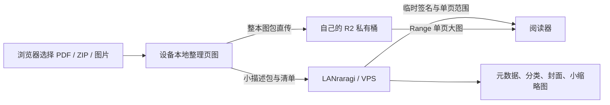

# LANraragi R2

[中文](README.md) · [English](README.en.md)

## 配套移动客户端：LanR2der

<a href="https://github.com/Fuzage/LanR2der"></a>

在 iPhone 或 Android 手机上连接本修改版书库，使用**拟物书架、R2 阅读、整本离线下载、App 内上传、元数据与分类编辑，以及隐私保护**。首次打开填写自己的服务器地址和 API Key。

**[进入 LanR2der 项目页，选择 iOS 或 Android 版本](https://github.com/Fuzage/LanR2der)**

iOS 要求 **26.0+**，IPA 未签名，需要自行签名安装。Android 要求 **9.0（API 28）+**。两种客户端首次打开都填写自己的服务器地址和 API Key。两个平台独立维护版本号；进入客户端项目页后，按设备选择对应 Release。

新版客户端支持**书架排列预设**：在书架左上角创建、切换、覆盖保存或刷新预设，书架层级和顺序保存在此 LANraragi 实例的 Redis 数据库中，供连接同一实例的 iOS / Android 设备同步使用。此功能需要更新到包含 `/api/lanr2der/shelf-presets` 接口的新版镜像；客户端切换或刷新时会替换本机当前排列，首次连接不会自动覆盖本机书架。升级时保留现有 `database` 持久化卷即可。

---

基于 [LANraragi 0.9.81](https://github.com/Difegue/LANraragi/tree/v.0.9.81) 的社区修改版，为原生上传页和阅读器加入 **Cloudflare R2 直传与按页读取**，降低漫画大图对 VPS 带宽和本地磁盘的占用。每位使用者填写自己的 Cloudflare 账号、桶和 S3 密钥。

每次翻页仍会请求对应的页范围；整包直传减少上传请求数量，不代表阅读请求计费消失。存储、读写请求和免费额度请以 Cloudflare 的实际账单与价格说明为准。

本仓库不是 LANraragi 官方发布。`latest` 指本修改版最近构建的镜像，**基础版本固定为 0.9.81**，不会自动跟随上游升级。

## 改了哪些地方

| 部分 | 本修改版的行为 |
| --- | --- |
| 原生 `/upload` 上传页 | 增加「上传到 R2」和「上传到 VPS」，支持多文件队列、每本进度、分类选择和新建分类；上传完成后可进入原有元数据编辑页 |
| 浏览器本地整理 | PDF 优先提取可复用的内嵌图片；ZIP/CBZ 中的 JPG、PNG、WebP 保持原始字节；需要像素解码的内嵌图会无损写成 PNG；无法直接提取的 PDF 页面才用 DPI 渲染成无损 WebP |
| R2 上传方式 | 整理后的页图拼成**每本一个数据包**直传 R2，避免每页独立上传；不重复上传原始 PDF/ZIP，也不额外把整本结果 ZIP 上传一遍 |
| 网页阅读器 | 通过已登记的偏移量和 HTTP Range，从 R2 图包中直接读取单页大图；支持翻页状态更新 |
| 服务端档案 | VPS 保存小型 CBZ 描述包、封面和页缩略图，以及原有 Redis 元数据、分类和阅读进度 |
| 删除档案 | 删除已登记的 R2 档案时清理关联对象，包括图包和远端清单；删除分类不会删除漫画 |
| R2 设置 | 管理页新增 `/config/r2`，支持启用开关、Endpoint、桶名、S3 密钥、签名有效期、连接检查和 CORS 示例 |
| 配置来源 | 支持网页配置和 Docker 环境变量；非空环境变量优先，网页对应字段只读；密钥留空时保留旧值 |
| 其他适配 | 修正 R2 页图清单的 Unicode 处理、描述包识别、档案大小/页数统计与进度更新；对私有接口设置缓存策略 |
| 发布方式 | Dockerfile 构建浏览器引擎；GitHub Actions 生成 amd64/arm64 镜像并发布到 GHCR |

**格式保留的含义：**不会为了统一扩展名而把原本的 JPEG/PNG/WebP 再编码。JPEG 本身可能有损，本项目不会让它恢复成原始无损画面；对于需要重新渲染的 PDF，输出编码虽无损，仍然是所选 DPI 下的栅格化结果。

## 数据与流量怎么走



| 保存位置 | 内容 |
| --- | --- |
| R2 | `reading/<批次>/book.bin` 图包和 `manifest.json` 清单 |
| VPS `content` | 小 CBZ 描述包；选择「上传到 VPS」时也保存原始档案 |
| VPS `thumb` | 封面、小页缩略图 |
| VPS `database` | Redis 数据、档案元数据、分类、进度，以及网页保存的 R2 配置 |
| 上传设备 | 处理时的本地数据；独立导入器生成的结果 ZIP 只用于本地下载 |

## 安装

需要 Docker 与 Docker Compose。首次发布的 GHCR 镜像须等工作流成功且包设为公开后才能匿名拉取。

### 使用发布的镜像

```sh
git clone https://github.com/Fuzage/LANraragi-R2.git
cd LANraragi-R2
cp .env.example .env
```

将 `.env` 中的镜像值改为：

```dotenv
LANRARAGI_IMAGE=ghcr.io/fuzage/lanraragi-r2:latest
```

```sh
docker compose pull
docker compose up -d --no-build
```

### 自己构建

```sh
git clone https://github.com/Fuzage/LANraragi-R2.git
cd LANraragi-R2
cp .env.example .env
docker compose up -d --build
```

访问 `http://你的服务器:3000`。初次安装的默认管理员密码为 `kamimamita`；登录后先改成自己的密码。通过公网使用时，请配置自己的 HTTPS 域名。端口可在 `.env` 的 `LANRARAGI_PORT` 中修改。

Compose 创建四个持久化卷：漫画/描述包、缩略图、数据库、侧载插件。`docker compose down` 不会自动删除这些卷；**不要用 `down -v` 升级**。

## Cloudflare：从没有 R2 开始配置

### 1. 开通 R2 并创建自己的桶

登录 [Cloudflare Dashboard](https://dash.cloudflare.com/)，进入 **Storage & databases → R2 → Overview**。没有开通时按页面完成 R2 订阅流程，再创建桶，例如 `my-comics`。名字使用 3–63 个小写字母、数字或连字符；首尾不能是连字符。桶名规则及创建方式见 [官方创建桶文档](https://developers.cloudflare.com/r2/buckets/create-buckets/)。

初次配置可使用默认位置与 Standard 存储类。保留桶的私有状态：本项目通过签名访问，**无需启用公共 r2.dev URL 或给桶绑定公共下载域名**。R2 开通与计费流程以 [官方入门说明](https://developers.cloudflare.com/r2/get-started/) 和 [价格页面](https://developers.cloudflare.com/r2/pricing/) 为准。

### 2. 生成 S3 访问密钥

在 R2 概览的 **Account Details → API Tokens → Manage** 中创建 R2 Token，选择 **Object Read & Write**，范围限定为刚创建的桶。创建后记录 **Access Key ID** 和 **Secret Access Key**；Secret 只在创建时显示一次。这里填写的是这对 S3 凭据，不能拿 Cloudflare 全局 API Key 或任意通用 API Token 替代。步骤见 [官方 R2 身份验证文档](https://developers.cloudflare.com/r2/api/tokens/)。

### 3. 取得桶的 Endpoint

复制 Cloudflare 给出的 **S3 API Endpoint**。常见格式如下；有司法区域限制的桶必须使用对应地址。详见 [官方 Endpoint 说明](https://developers.cloudflare.com/r2/api/tokens/)。

```text
默认：https://<ACCOUNT_ID>.r2.cloudflarestorage.com
EU：  https://<ACCOUNT_ID>.eu.r2.cloudflarestorage.com
US：  https://<ACCOUNT_ID>.us.r2.cloudflarestorage.com
```

Endpoint 只填主机地址，**不追加 `/桶名`**。桶名单独填写；`https://某名称.r2.dev` 和你的 LANraragi 网站地址都不是 S3 Endpoint。

### 4. 配置 CORS

打开 **R2 → 你的桶 → Settings → CORS Policy → Add CORS policy**，选择 JSON 并保存以下模板。把 `https://comics.example.com` 换成实际打开 LANraragi 的来源。也可以直接复制本项目 R2 设置页生成的规则。[官方 CORS 操作说明](https://developers.cloudflare.com/r2/buckets/cors/)

```json
[
  {
    "AllowedOrigins": ["https://comics.example.com"],
    "AllowedMethods": ["PUT", "GET", "HEAD"],
    "AllowedHeaders": ["content-type", "range"],
    "ExposeHeaders": ["ETag", "Content-Range", "Content-Length"],
    "MaxAgeSeconds": 3600
  }
]
```

来源由**协议、主机和可选端口**组成，不带路径或结尾 `/`。例如 `http://localhost:3000` 和 `https://comics.example.com` 是两个来源；需要都能上传时一起列入数组。本项目的单页读取需要 Range，模板中的响应头供阅读器检查页范围。签名地址提供授权，浏览器跨域访问仍需 CORS；CORS 本身不会使桶公开。[官方签名 URL 与跨域说明](https://developers.cloudflare.com/r2/api/s3/presigned-urls/)

## LANraragi：启用修改版的 R2 功能

### 网页配置

1. 打开 **管理设置 → R2 存储设置**，或访问 `/config/r2`。
2. 填入自己的 Endpoint、桶名、Access Key ID 和 Secret Access Key。
3. 选择开启 R2，保存。
4. 点击「检查已保存的连接」。这一步确认能读取该桶，**不会创建测试对象，也不等于已验证写入或浏览器 CORS**。
5. 按上一节配置桶的 CORS，再上传一本小漫画做完整检查。

密钥不回显，留空会保留已保存值；输入新值即可更换。网页配置存放在持久化数据库中，其他工作进程最多约两秒看到更新。普通漫画元数据 JSON 备份不包含 R2 密钥，但完整数据库卷包含它们，应作为私密备份保存。

关闭 R2 不会删除对象，但 R2 漫画也无法继续获得新的有效阅读签名。更换账号或桶前应迁移对象并保留对象路径，否则已登记的漫画会找不到页图。

### 环境变量配置

`.env` 中 R2 字段留空时使用网页设置。非空环境变量优先，网页显示为只读；`LRR_R2_ENABLED=0` 明确关闭 R2。

```dotenv
LRR_R2_ENABLED=1
LRR_R2_ENDPOINT=https://YOUR_ACCOUNT_ID.r2.cloudflarestorage.com
LRR_R2_BUCKET=my-comics
LRR_R2_ACCESS_KEY_ID=YOUR_ACCESS_KEY_ID
LRR_R2_SECRET_ACCESS_KEY=YOUR_SECRET_ACCESS_KEY
LRR_R2_PUT_TTL=21600
LRR_R2_GET_TTL=43200
```

修改环境变量后执行 `docker compose up -d --force-recreate`。`.env` 不提交到 GitHub，也不复制进镜像。签名有效期单位为秒，范围 60–604800；上面的上传/阅读默认值分别是 6 小时和 12 小时。

## 上传、阅读与删除

- 在 `/upload` 点击「上传到 R2」，可一次选多本；按需要选分类或新建分类，右侧显示每本状态。
- PDF 提取、解包和需要的转码都在**上传设备**执行。上传期间保持页面打开；手机进入后台可能暂停或中断。
- 页图整理完成后上传整本数据包，随后 VPS 校验对象并登记档案。出现「正在校验并登记」时，大图已传完，仍需等待完成提示。
- `/r2-import/index.html` 保留独立导入器；原生上传页适合批量任务。
- 阅读大图直接走 R2。封面、列表缩略图、元数据请求继续走 LANraragi。
- 删除漫画会删除其已登记 R2 对象；分类只是组织信息，删除分类不会删除漫画。
- 上传中断且尚未登记的对象不会自动成为档案，可能留下孤立批次。当前没有自动孤立对象回收器；不要仅凭“书库没有漫画”就直接清空桶。

## 升级、恢复与兼容性

升级已有 0.9.81 部署前，备份数据库、漫画/描述包和缩略图，并保留原卷映射。更换镜像不会把已有 VPS 漫画自动迁到 R2；需要另行导入。不要把新建的空数据库卷误当作原数据库。

元数据 JSON 能备份档案信息和 R2 页图映射，**不能代替 R2 对象备份**。完整恢复同时需要数据库/描述包与桶内对象。离线原 PDF/ZIP 如果需要留存，应在自己的备份中保留；本修改版默认只上传阅读页图。

第三方客户端需要支持清单中的 `ranges`，发送 `Range`，并处理 `206 Content-Range`。只把 `/files` 返回的每个 URL 当作普通单页图片下载的旧客户端，可能下载到完整数据包而无法解码。本仓库已适配自己的网页阅读器。

当前限制：每本 500 页、整包 5 GiB；本实现使用单个 PUT，尚无断点续传/分段续传；图片格式为 JPG/PNG/WebP，R2 导入暂不支持 RAR/7z。R2 可用性和手机/家庭网络的实际速度需要自行测量，不能保证特定地区的速度。

## 常见问题

| 现象 | 检查位置 |
| --- | --- |
| 设置字段只读 | 容器已有非空 `LRR_R2_*`；清空对应环境值并重建容器，才能改用网页值 |
| “R2 未启用” | 开关及四项必填字段；环境值 `0` 会覆盖网页开关 |
| 连接检查失败 | S3 Endpoint、桶名、两项凭据、令牌的桶范围和对象权限、VPS 网络 |
| 连接成功但上传 `Load failed`/跨域错误 | 桶 CORS 是否包含实际网页来源、PUT、content-type；另确认写入权限 |
| 封面正常、大图失败 | R2 是否启用、对象是否还在、Range/CORS 是否完整、客户端是否支持图包范围 |
| `SignatureDoesNotMatch` | 使用整条新签名地址，勿手动改域名、路径、参数或编码；同时检查系统时钟与正确密钥 |
| 新增/删除后页面仍显示旧结果 | 反向代理/Cloudflare 是否缓存了 `/api/*` 等动态接口 |
| 更新后库变空 | 是否启动了新的空数据库卷，而没有挂载原数据库 |

## 开发与镜像发布

`Dockerfile` 使用官方 0.9.81 运行环境，并在 Node 构建阶段从锁文件构建浏览器导入器。生成的 `public/r2-import` 不需提交 Git。

```sh
docker build -t lanraragi-r2:local .
```

`.github/workflows/r2-image.yml` 在 `main` 推送、`v*` 标签推送或手动运行时，检查配置逻辑并构建 `linux/amd64`、`linux/arm64` 镜像。目标为 `ghcr.io/<仓库所有者>/<仓库名>`，使用 GitHub 自带的 `GITHUB_TOKEN`。若 fork 后 Actions 尚未启用，先启用，再从 `main` 手动运行工作流。第一次成功发布后，在 Packages 中把镜像包设为 Public，其他人才能匿名拉取。

本地已经验证镜像构建、网页设置保存、凭据留空保留、不回显、CSRF 拒绝、环境优先级和重启持久化。没有以“连接检查”代替实际上传与阅读的验证。

## 许可与来源

保留 LANraragi 上游 MIT 许可证 [COPYING](COPYING)，上游说明见 [README.upstream.md](README.upstream.md)。浏览器第三方许可随镜像保留，见 [THIRD_PARTY_NOTICES.md](THIRD_PARTY_NOTICES.md)。Cloudflare 控制台操作对照官方文档核实于 2026-10-14，界面文案可能调整。
